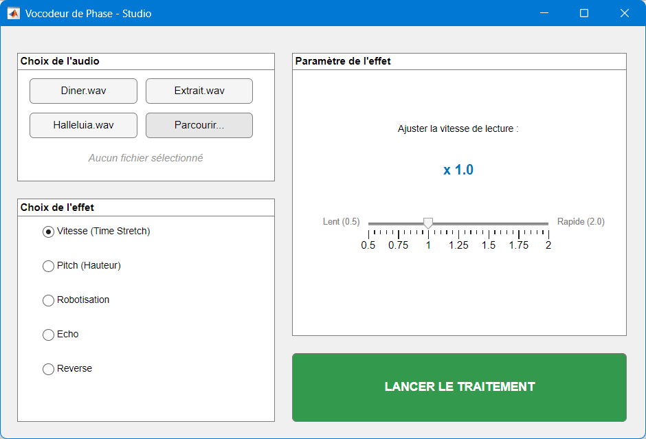
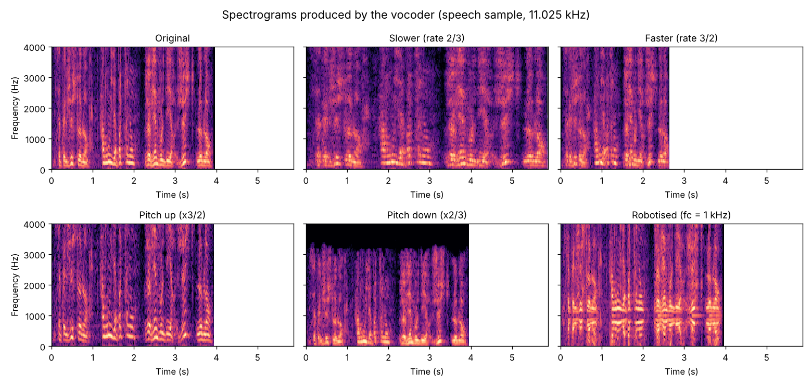

<div align="center">

# 🎙️ Phase Vocoder – Speed, Pitch & Voice Effects in MATLAB

**Change the speed of a recording without changing its pitch, change the pitch without changing its speed, and robotise a voice, using the short-time Fourier transform**




</div>

> [!NOTE]
> 🇫🇷 **This project was carried out in French.** Code comments, file names (`Vocodeur.m`, `effet_echo.m`…) and the interface labels are in French. This README is in English so the project can be read by a wider audience.

---

## 📖 About

Project for the **Signal Processing** course (academic project, November 2025), carried out as a **team of two students**.

A **phase vocoder** analyses a sound frame by frame in the frequency domain (short-time Fourier transform, STFT), modifies the frames, then rebuilds the signal. Working on the **phase** of each frame is what lets us stretch time without changing the pitch, and the reverse.

### Effects
| Effect | How |
|---|---|
| ⏩ **Speed** (time-stretch) | STFT interpolation on a new time base, pitch unchanged |
| 🎵 **Pitch** (up / down) | time-stretch, then resampling to get the original duration back |
| 🤖 **Robotisation** | modulation of the voice by a carrier at 200, 500, 1000 or 2000 Hz |
| 🔁 **Echo** | delayed (250 ms) and attenuated (×0.6) copy added to the signal |
| ⏪ **Reverse** | time reversal |

## ⚙️ How it works


**Time-stretch (`PVoc` + `TFCT_Interp`).** The STFT gives a matrix of frames. A new time base `0 : rate : N-2` is created: a rate below 1 gives more frames (slower), above 1 gives fewer frames (faster). For each new position between two original frames:
- the **magnitude** is linearly interpolated between the two frames;
- the **phase** is accumulated from the expected phase advance of each frequency bin (2π·hop·k/N) plus the measured deviation, wrapped to [−π, π]. This keeps the phase coherent from one frame to the next, which avoids the "phasey" artefacts of a naive approach.

**Pitch shift.** Stretching by `a/b` then resampling by `a/b` brings back the original duration while multiplying all frequencies by `b/a`.

**Robotisation (`Rob`).** The signal is multiplied by a complex carrier e^(j2πf<sub>c</sub>t) and the real part is kept, which shifts the spectrum around f<sub>c</sub> and gives the metallic voice.

## 🧪 Results

<div align="center">

</div>

Measured on a 3.98 s speech recording (fundamental frequency ≈ 184 Hz):

| Effect | Duration | Fundamental frequency |
|---|---|---|
| Original | 3.98 s | 184 Hz |
| Slower (rate 2/3) | **5.87 s** (×1.48) | 190 Hz, pitch kept |
| Faster (rate 3/2) | **2.65 s** (×0.67) | 208 Hz, pitch kept |
| Pitch up (×3/2) | 3.96 s, duration kept | **262 Hz** |
| Pitch down (×2/3) | 3.97 s, duration kept | **140 Hz** |

The spectrograms show it clearly: speed changes stretch or compress the time axis while the harmonics stay at the same height; pitch changes move the harmonics up or down while the duration stays the same.

## 🖥️ Usage

Requirements: **MATLAB** with the **Signal Processing Toolbox** (`resample`, `spectrogram`).

```matlab
cd src
InterfaceVocodeur   % graphical interface: choose a file, an effect, then "LANCER LE TRAITEMENT"
Vocodeur            % or the full demo script: every effect with sound and figures
```

### 🔊 About the audio files
The recordings used during the project (a speech sample and two music excerpts) were **provided by the course** and are **not redistributed** here because their copyright belongs to their owners. To try the vocoder, use your own recordings:
- in the interface, click **Parcourir…** (*Browse*) and pick any `.wav` file;
- in `Vocodeur.m`, change the `audioread('...')` line at the top.

Mono or stereo files work (only the first channel is processed). Speech recordings give the clearest results.

## 📁 Repository structure

```
src/
├── Vocodeur.m            # main demo script: speed, pitch, robotisation + figures
├── InterfaceVocodeur.m   # graphical interface (uifigure)
├── PVoc.m                # phase vocoder: STFT -> interpolation -> inverse STFT
├── TFCT_Interp.m         # STFT interpolation with phase propagation
├── Rob.m                 # robotisation
├── effet_echo.m          # echo effect
├── effet_reverse.m       # reverse effect
├── TFCT.m                # STFT (provided by the course)
└── TFCTInv.m             # inverse STFT (provided by the course)
docs/                     # images used in this README
```

## 🧠 What I learned

- The STFT as a time-frequency representation, and the trade-off between window length, time resolution and frequency resolution.
- Why phase matters: interpolating only magnitudes breaks the signal; propagating the phase keeps it coherent.
- How time-stretching and resampling combine into pitch shifting.
- Validating DSP results both by ear and with measurements (durations, fundamental frequency, spectrograms).
- Building a small MATLAB application with a graphical interface around signal-processing functions.

## 🙏 Credits

- Project subject, `TFCT.m`, `TFCTInv.m`, the `PVoc.m` structure and the test recordings: course team.
- The STFT interpolation is inspired by a phase vocoder program from Columbia University, as noted in `TFCT_Interp.m`.
- The spectrograms in this README were produced by running this code (with GNU Octave) on the course speech sample.

## 👤 Author

**Sivaharan Kumara Segaram**, embedded systems engineering student. Project carried out with a teammate.
